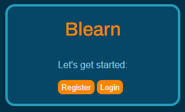
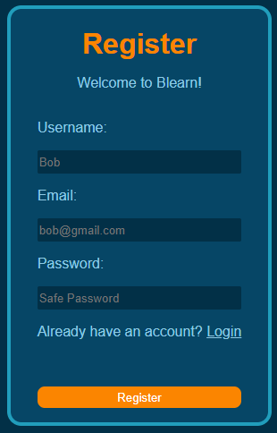
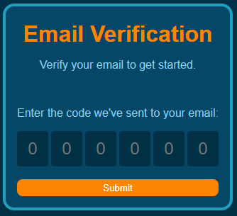
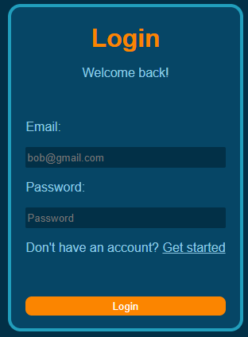

# Blearn v6

  

A tool for students packed with many features. 
For example students will be able to enter their homeworks into the homework module and they will get a notification when the homework is about to be overdue.

## Current state

As of now there are only the auth routes. They include all pages and api endpoints that are required to have a secure authentication.

The register page:

  
This is where people register. The credentials are getting sent to the server, which runs some checks and and returns a userId.

  
The user will receive an email with a 6 digit verification code, which they have to enter here.

  
If a user is already registered, they can log in at here.

## Notes

I made this a few times now, but I almost always made it with like 95% AI and never actually finished it (except [blearn v2](https://github.com/BigB132/blearn-v2))

This project may take 2-3 weeks  
Features I want to add:  

- [x] Authentication  
- [ ] Subjects  
- [ ] Time Schedule  
- [ ] Homeworks (with notifications 1d before due)  
- [ ] Learn Path Generator (using AI) 
- [ ] Vocabulary learning tool with flash cards (you can scan vocab pages and AI will turn it into the flash cards)  
